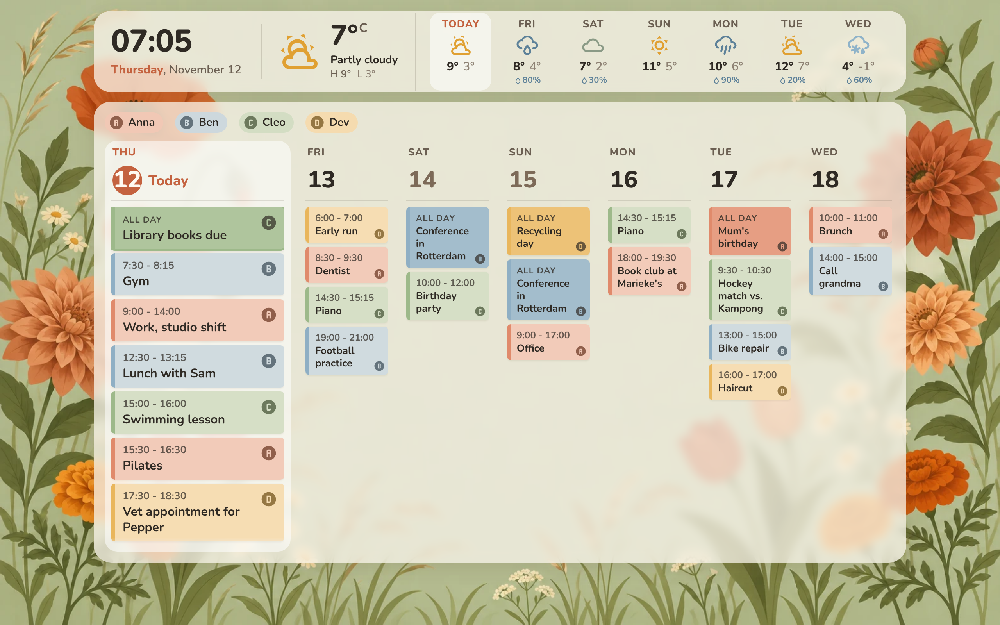
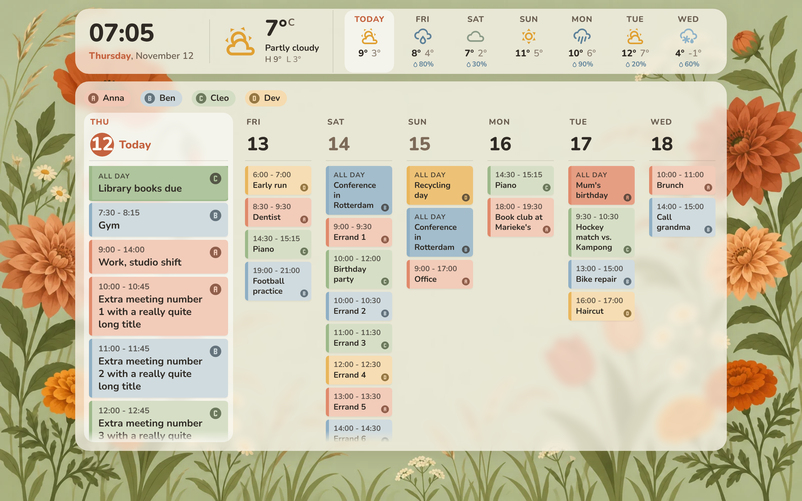

# Skylight Garden Calendar: week-planner-card for a Facebook Portal (1280×800)

A Skylight-style weekly family calendar for Home Assistant:
- A rolling 7 days, with **today as a wide first column**.
- **Person-colored event pills**, each with a letter badge and a legend.
- A **clock + live weather + 7-day forecast strip** across the top.
- Everything sits on frosted cream panels framed by the botanical meadow background.



A busy day scrolls inside its own column (touch-swipe on the Portal) with a soft fade; the rest of the layout doesn't move:



## What goes where

| File in this folder | Goes in Home Assistant | What it is |
|---|---|---|
| `skylight-calendar.yaml` | Dashboard → ✏️ → ⋮ → **Raw configuration editor** | The whole dashboard: view, weather strip, week-planner-card config, person mapping, card-mod CSS |
| `themes/skylight-garden.yaml` | `/config/themes/skylight-garden.yaml` | Background, fonts, colors, frosted panels, the 1280×800 layout sizes |
| `www/skylight/skylight-weather-strip.js` | `/config/www/skylight/skylight-weather-strip.js` | Small custom card for the top strip (new file, not a fork) |
| `www/skylight/meadow.png` | `/config/www/skylight/meadow.png` | Background image |
| `www/skylight/fonts/*` | `/config/www/skylight/fonts/` | Nunito font (SIL OFL), served locally |

`preview/` and `screenshots/` are only for development and testing. Don't copy them to HA.

## Install

1. **HACS → Frontend**: install
   - **week-planner-card** (tested with v1.14.1)
   - **card-mod**
   - **kiosk-mode**

   Then reload the browser.
2. **Copy files**: copy the `www/skylight/` folder to `/config/www/skylight/`, using the Samba, File editor or Studio Code Server add-on. Restart HA if `/config/www` didn't exist before.
3. **Background image**: replace `/config/www/skylight/meadow.png` with your original `Terracotta Botanical Meadow Frame.png`, renamed to `meadow.png`. The copy here was converted from the chat preview, so it's slightly softer than your original.
4. **Theme**: copy `themes/skylight-garden.yaml` to `/config/themes/`. Make sure `configuration.yaml` has:
   ```yaml
   frontend:
     themes: !include_dir_merge_named themes
   ```
   Then run **Developer tools → Actions → `frontend.reload_themes`**.
5. **Resource**: go to Settings → Dashboards → ⋮ → **Resources** → *Add resource*. Set the URL to `/local/skylight/skylight-weather-strip.js` and the type to **JavaScript module**.
6. **Dashboard**: create a new dashboard (e.g. "Portal"), open the **Raw configuration editor**, paste `skylight-calendar.yaml`, then edit the `# <<< CHANGE ME` lines (see below).
7. **On the Portal**: open the dashboard URL (e.g. `http://homeassistant.local:8123/dashboard-portal/calendar`) in the browser, full screen, at 100% zoom.
   - Kiosk-mode hides the HA header and sidebar, so the view uses the full 1280×800.
   - To edit later, append `?disable_km` to the URL.

## Placeholders to change

All are in `skylight-calendar.yaml` and marked `# <<< CHANGE ME`:

| Placeholder | Meaning |
|---|---|
| `weather.home` | Your weather entity. It must support daily forecasts; most integrations do, e.g. Met.no. |
| `calendar.person_1` … `calendar.person_4` | One calendar entity per person |
| `name: Anna` … | The person's name, shown in the legend and in the event pop-up |
| `color: "#E08A6B"` … | The person's color |
| `icon: mdi:alpha-a-circle` … | The person's badge on every event. Use the first letter of their name (`mdi:alpha-x-circle`), or any MDI icon. |

There's a commented-out fifth person ready to use.

**Default palette.** It's drawn from the background art and keeps dark text readable. Contrast of the dark text on the pill colors is between 5.4:1 and 10.8:1.

| Name | Color |
|---|---|
| terracotta | `#E08A6B` |
| dusty blue | `#8FAFC4` |
| sage | `#9DB98A` |
| marigold | `#E9B65C` |
| plum-rose | `#C995A8` |

Pills use a light tint of the person's color with a solid color edge. All-day events use the stronger color, like Skylight's banners.

## Behavior

- **Today column**:
  - About 2× the width of the other days. Change it with `flex-grow: 2.1` in the card-mod block.
  - Has a white highlight, a terracotta circled date and larger text.
  - Titles wrap up to 4 lines there and 3 lines in the narrow columns. They're never cut off on one line.
- **Event states**: past events fade, and the event happening now gets a colored ring. Tapping an event opens week-planner-card's normal detail pop-up.
- **Legend**: tapping a person hides or shows their events (`legendToggle`).
- **Empty days**: show nothing. The "No events" text is gone.
- **Weather strip**:
  - Data comes from `weather.get_forecasts` (daily), called through HA's own WebSocket. It refreshes every 30 minutes and whenever the weather entity updates.
  - Tapping the strip opens the weather entity's details.
  - The `days` option sets how many forecast tiles are shown.
- **Fully local**: icons are HA's built-in MDI icons, and the font is served from `/local/`. Nothing loads from the internet.
- **Sizing**:
  - The theme sets the vertical layout: 14px gap, 104px strip, 12px gap, the calendar panel, then 80px of flowers at the bottom.
  - Both panels sit 120px in from the left and right edges.
  - To resize, adjust `skylight-strip-*` / `skylight-panel-*` in the theme.

## How it's built and what can break on updates

- **No fork of week-planner-card.** The card's day columns are sized with plain CSS inside a flex container, so card-mod can widen `.day.today`. Each event carries its calendar color as `--border-color`, so the pills can be filled with it.
- **The only new code is `skylight-weather-strip.js`.** week-planner-card has no top weather strip; its own weather is a small per-day icon from the forecast subscription. That's why the card's `weather:` option is left out.
- **Update risk.** The card-mod CSS relies on some of week-planner-card's internal markup:
  - **Documented and fairly stable:** `.day.today`, `.event.fullday`, `.event.past` / `.ongoing`, `data-entity`.
  - **Internal, not documented:** `.container`, `.date .number`, `.event .inner` / `.time` / `.title` / `.icon`, `.legend ul li`, the `--border-color` and `--legend-calendar-color` variables, and the `dayFormat` HTML.

  If a future week-planner-card release renames these, the card keeps working but loses parts of the styling. Then update the selectors in `card_mod`. Selectors are prefixed with `ha-card` because card-mod's styles otherwise lose to the card's built-in styles when specificity is equal.
- **Weather API.** `weather.get_forecasts` (HA 2023.12+) is the current, supported forecast API.
- **Layout assumption.** The wide-today layout assumes `startingDay: today`. With `showNavigation`, paging to another week simply shows 7 equal columns.

## Preview harness (development only)

`preview/render.mjs` renders the real week-planner-card build with this exact YAML, theme and card-mod CSS. It uses a mocked `hass` (fake events and forecast) in Playwright at 1280×800. It checks:
- No page scroll.
- No clipped event times.
- Fonts are local.
- `get_forecasts` is called.
- Clicking an event opens the detail dialog.

It aborts any external request it sees. Scenarios: `normal`, `heavy`, `empty`.

```bash
node dashboard/preview/render.mjs path/to/week-planner-card.js path/to/@mdi/js out/ normal
```
